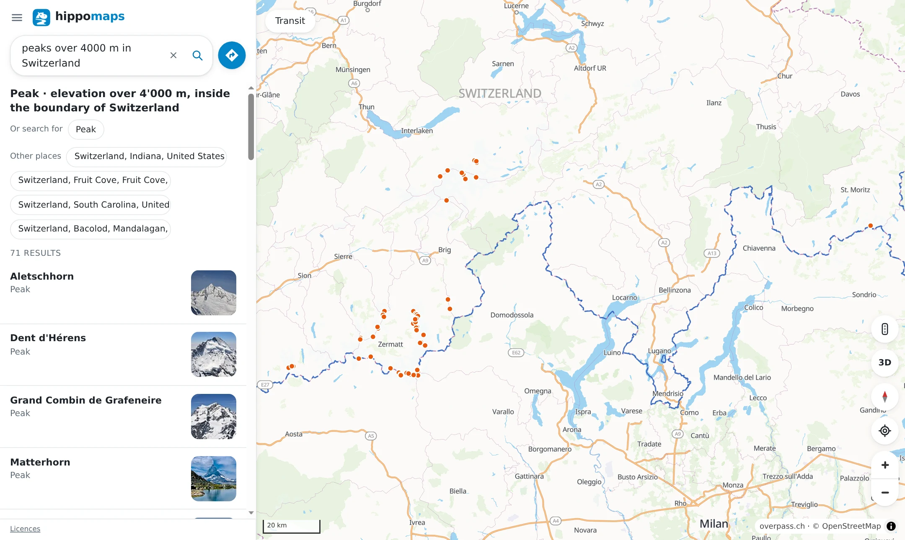
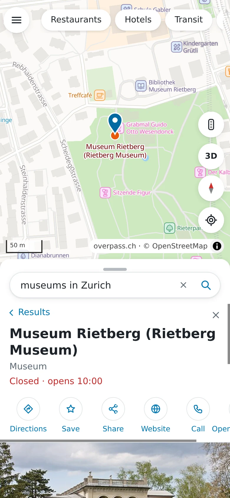
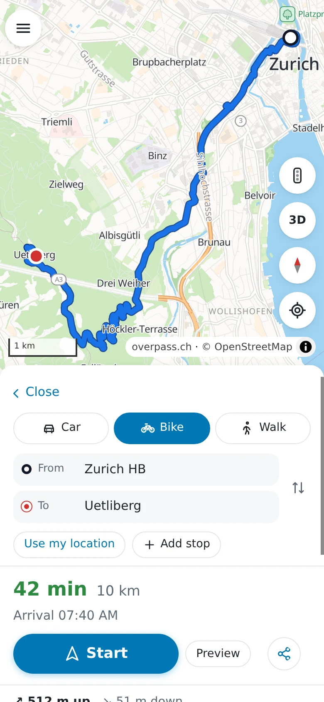

<div align="center">


# hippomaps

A map app for the web and Android: search in plain words, place pages, directions, public transport and turn-by-turn
navigation, on OpenStreetMap data.

[**hippomaps.ch**](https://hippomaps.ch) · [Android app](android/README.md) · [Changelog](CHANGELOG.md) ·
[Licence](#licence)



</div>

<table>
  <tr>
    <td width="20%"></td>
    <td width="20%"></td>
    <td width="20%"></td>
    <td width="20%"></td>
    <td width="20%"></td>
  </tr>
  <tr>
    <td align="center"><b>Search</b><br>in plain words</td>
    <td align="center"><b>Places</b><br>hours, photo, contact</td>
    <td align="center"><b>Directions</b><br>car, bike, on foot</td>
    <td align="center"><b>Navigation</b><br>spoken turn by turn</td>
    <td align="center"><b>Public transport</b><br>times, tracks, delays</td>
  </tr>
</table>

## Features

### Search and places

- Search in plain words: "cafés in Zurich by the Limmat", "peaks over 4000 m in Valais"
- Place pages with photo, opening hours, website, phone, wheelchair access and Wikipedia
- A picture, menu and opening hours from the website of a place when OpenStreetMap has none
- Popups with name, kind, hours and address on a tap, or under the mouse on a computer
- A tap on the map shows the address and the places around it
- A right click or long press: directions from or to the point, Measure, Reachable area, coordinates

### Directions and navigation

- Car, bike and on foot, up to 8 stops
- Up to two other routes, with the extra time of each
- Lanes, junction signs, speed limits and places along the route
- Height profiles by bike and on foot
- Public transport, with tracks and delays (Europe on hippomaps.ch)
- Stop signs, speed bumps and speed cameras on car routes; cameras only where the law allows (`server/marks.go`)
- Spoken turn-by-turn navigation in 18 languages, with a 3D traveller
- Offline along the route: the map is saved at Start (about 15 MB for 25 km by car)
- Live traffic in Switzerland, the Netherlands and France

### Map

- Nine styles; the day map in the colours of Swiss topographic maps; day and night by the sun
- 3D terrain and buildings, relief shading
- Metro, light rail and tram lines in their colours
- The map turns with the phone (compass)
- Measure distance and area, with a height profile; GPX, KML and GeoJSON in and out
- Reachable area by car, bike, on foot or public transport, in up to four time bands
- Search results and routes as GPX for a GPS device (not in the Android app)
- English, German, French and Italian
- Settings, starred places and recent searches stay in the browser
- Feedback from the menu, and "Report this problem" under a failed search or route

### Android

- Native location and navigation in the background
- Opens links from other map apps (`geo:`, Google Maps, OpenStreetMap, Apple Maps)

## How it works

A Go server serves the page (`web/`, plain JavaScript and MapLibre, no build step) and relays what the browser needs
to other services:

| Service | Used for | Setting |
|---|---|---|
| Map tiles API ([overpass.ch](https://overpass.ch) maps, or a gateway with the same paths) | vector and terrain tiles, styles, geocoding | `TILES_URL`, `MAPS_KEY` |
| [overpass-search](https://gitlab.com/cdutsov/overpass-search) | search | `SEARCH_UPSTREAM` |
| [Valhalla](https://github.com/valhalla/valhalla) | directions, lanes, speed limits | `ROUTING_URL` |
| [MOTIS](https://github.com/motis-project/motis) 2.11.4 with GTFS timetables, no street data needed | public transport | `JOURNEY_URL`, `JOURNEY_REGIONS` |
| Overpass API | transit lines, places and signs along a route | `OVERPASS_URL`, or overpass.ch with `ELEVATION_KEY` |
| overpass.ch elevation API | height profiles | `ELEVATION_URL`, `ELEVATION_KEY` |
| [Piper](https://github.com/OHF-Voice/piper1-gpl) 1.5 or later behind `/say?lang=&text=` (`server/say.go`) | spoken navigation (else the voices of the browser) | `TTS_URL` |
| A traffic service with `/incidents.json` | live traffic | `TRAFFIC_URL` |
| Wikidata and Wikimedia Commons | photos and logos | `PICTURES` |
| Websites of places (as robots.txt allows), [Panoramax](https://panoramax.fr) | pictures, menus and hours missing in OpenStreetMap (`server/place.go`) | `PICTURES`, `PANORAMAX_API` |
| [DB-IP City Lite](https://db-ip.com/db/download/ip-to-city-lite) (MMDB, CC BY 4.0) | the start view at the town of the visitor | `GEOIP_DB` |
| [Stripe](https://stripe.com) Checkout | donations (not in the Android app) | `STRIPE_KEY`, `PUBLIC_URL` |
| An SMTP server | feedback by e-mail | `FEEDBACK_TO`, `SMTP_*` |

Only the tiles are required; without its setting a feature is left out of the page.

## Run

```
go run ./cmd/hippomaps                        # :8096, the page on /labs/maps
docker build -t hippomaps . && docker run -p 8096:8096 -e BASE_PATH=/ hippomaps
```

The Docker build runs `go vet` and the tests.

## Settings

| Setting | Default | |
|---|---|---|
| `LISTEN` | `:8096` | address |
| `BASE_PATH` | `/labs/maps` | path of the page; `/` for a site of its own |
| `PUBLIC_URL` | | public address; makes the page indexable (canonical link, `robots.txt`, `sitemap.xml`) |
| `TILES_URL` | `https://api.overpass.ch` | map tiles API |
| `MAPS_KEY` | | key of the tiles API, sent to the browser |
| `SEARCH_UPSTREAM` | | overpass-search, relayed under `{base}/api/search` |
| `SEARCH_API` | `/labs/search/api` | search API for the browser when not relayed |
| `ROUTING_URL` | | Valhalla |
| `JOURNEY_URL` | | MOTIS; walks to the stops come from `ROUTING_URL`, else straight lines |
| `JOURNEY_REGIONS` | | where MOTIS has timetables: country codes (`CH,BG`) or a UN region (`150`: Europe) |
| `OVERPASS_URL` | | Overpass API, asked without a key |
| `ELEVATION_URL` | `https://api.overpass.ch` | elevation API |
| `ELEVATION_KEY` | | overpass.ch key for elevation (and Overpass without `OVERPASS_URL`), server side only |
| `TTS_URL` | | Piper server |
| `TRAFFIC_URL` | | traffic service |
| `GEOIP_DB` | | MaxMind DB file (DB-IP City Lite or GeoLite2 City); else the map opens in Zurich. A new file is picked up within a minute. `hippomaps geoip FILE ADDRESS…` tests it |
| `SERVICE_WORKER` | `on` | `off` removes the service worker and its caches from browsers at their next visit |
| `STRIPE_KEY` | | restricted Stripe key with Checkout Sessions: Write (`server/donate.go`), needs `PUBLIC_URL`. 10 checkouts per visitor in 10 minutes |
| `FEEDBACK_DIR` | | directory for feedback messages (`server/feedback.go`), a JSON file each, no IP address, deleted after a year. `hippomaps feedback` prints the last ones. 5 per visitor an hour |
| `FEEDBACK_TO` | | also send each message to this address (Reply-To: the visitor), through `SMTP_HOST`, `SMTP_PORT` (587 STARTTLS, 465 TLS), `SMTP_USER` (the sender), `SMTP_PASSWORD` |
| `STATS_DIR` | | directory for `stats.json`: page loads, visitors and referrers per day (UTC). No addresses or cookies stored. `hippomaps stats` prints them |
| `STATS_IGNORE` | | addresses and networks (comma separated) not counted |
| `PICTURES` | `true` | photos and logos from Wikimedia |
| `PICTURE_CACHE_MB` | `64` | memory for Wikimedia answers and thumbnails |
| `PANORAMAX_API` | `https://api.panoramax.xyz` | street pictures for places without one; empty: none |
| `PICTURES_PER_IP`, `ROUTES_PER_IP`, `SAYS_PER_IP`, `SEARCHES_PER_IP` | `600`, `120`, `600`, `100` | per visitor in 10 minutes (map taps: three times the searches; public transport counts as directions) |
| `USER_AGENT` | `hippomaps/<version> (+https://gitlab.com/cdutsov/hippomaps)` | for Wikimedia and the other services |

Limits count by `X-Forwarded-For`, so run the server behind a proxy that sets it.

## Server API

Under `{base}/api/`; errors are `{"error":{"code","message"}}`.

| | |
|---|---|
| `GET picture?wikidata=Q…&brand=Q…&commons=File:…&w=120` | thumbnail of the place photo, else the chain logo, with credit headers |
| `GET place?osm=node/123&pic=1` | from the website of the place: `web`, `site`, `menu`, `hours`; with `pic=1` a `picture` (`url`, `kind`, `credit`, `source`, `page`). Cached a week |
| `GET place/picture?osm=node/123` | that picture, re-encoded (500 px, no metadata) |
| `GET kinds?lang=` | names of the POI kinds of the map tiles in that language |
| `GET route?from=lat,lon&via=…&to=…&mode=car\|bike\|walk&lang=&alts=2` | line, steps, stops, speed limits, lanes, traffic, tunnels, signs (`marks`), height profile; `alts`: other routes |
| `GET journey?from=lat,lon&to=…&time=…&arrive=1&page=&lang=` | public transport connections: legs with line, tracks, stops and delays; `earlier` and `later` page through them |
| `POST along` `{"line","cat","mode","lang"}` | places of a kind near a route, in route order |
| `POST heights` `{"line":[[lon,lat],…]}` | height profile of a line: `up`, `down`, `min`, `max`, `pts`; 2 to 5000 points, 2000 km at most. Needs `ELEVATION_KEY` |
| `GET reach?at=lat,lon&mode=car\|bike\|walk\|transit&min=15,30,45,60` | isochrones as GeoJSON, a MultiPolygon per time; up to 60 minutes (bike and on foot 120), leaving now |
| `GET transit?tile=10/x/y` | transit lines of a tile as GeoJSON |
| `GET say?lang=&text=` | spoken sentence (audio/mpeg) |
| `GET traffic` | traffic incidents |
| `POST feedback` `{"kind","text","email","lang","ctx"}` | a feedback message: `kind` `bug`, `map`, `idea` or `other`, `text` up to 4000 characters; 204 |
| `GET search/{search,query,complete,here}` | overpass-search, with its English words translated for `lang=de`, `fr`, `it` (`server/labels.go`) |

`GET {base}/sw.js` is the service worker (`web/sw.js`): the page as last loaded, and the tiles of the route being
navigated (cache `hm-route`).

Files under `static/` carry their hash in the address and are cached for a year. `web/early.js` fetches the MapLibre
worker, the style and the first tiles while the scripts load. MapLibre does not validate the styles at run time
(`UNCHECKED` in `app.js`); `tests/browser.py` does.

`GET /privacy` and `/de/privacy` serve the privacy policy. `GET /healthz` answers `ok` (`hippomaps healthcheck`, the
Docker health check).

## Android

`android/` holds the app (Kotlin, one activity, AndroidX only, no Google Play services). `android/build.sh` builds the
signed APK and AAB in Docker, reproducibly. APKs are on the [GitLab releases](https://gitlab.com/cdutsov/hippomaps/-/releases);
F-Droid from February 2027 (its three-month rule), Google Play in review ([android/PLAY.md](android/PLAY.md)). Store
texts and screenshots are in `fastlane/`. Details: [android/README.md](android/README.md).

## Tests

- `go test ./...`: the server against fakes of the services it calls
- `tests/site-test.sh` (`PAGE=https://…`): a running site end to end; `BROWSER=1` adds headless Chromium on a phone
  screen (`tests/browser.py`)

## Layout

```
cmd/hippomaps/   settings, server, healthcheck
server/          page, pictures, directions, journeys by public transport, search relay, transit lines, traffic, voice
web/             index.html, app.js, i18n.js, early.js (the first requests), avatar.js (3D traveller), sw.js (service worker), app.css, icons, vendor/
android/         the Android app
fastlane/        F-Droid texts and screenshots
tests/           tests of a running site
docs/img/        the pictures of this page
CHANGELOG.md     what changed, by release of the Android app
```

## Licence

GPL-3.0-or-later (`LICENSE`). `web/vendor/` holds maplibre-gl 6.13.0 (BSD-3-Clause), three.js 0.170.0 (MIT),
opening_hours 3.15.0 (LGPL-3.0-only) and suncalc 2.0.1 (BSD-2-Clause), each with its licence. `server/labels/presets.json` holds
the names of the iD presets (id-tagging-schema 7.2.0, ISC), built by `server/labels/gen.py`, licence in `server/labels/LICENSE-id-tagging-schema.md`.

Map data © OpenStreetMap contributors (ODbL). Pictures from Wikimedia Commons under the licence each credit names. Traffic:
Federal Roads Office (FEDRO) Traffic Data Platform (TDP), NDW (CC0), Bison Futé (Licence Ouverte 2.0). Places of IP addresses: IP Geolocation by DB-IP (CC BY 4.0, not in the
repository; the privacy policy credits it with a link). Voices (Piper, not in the repository): under CC BY the French from the SIWIS
database and Hi-Fi TTS, the Italian from serena-synthetic-it-27h (Marco Baccarani), the Estonian from the speech corpus of Estonian
news sentences and LibriTTS-R; the others CC0 or public domain. All are credited on `/licences`. None is from the research-only lessac voice.

---

<div align="center">

Maps, search and elevation by

<a href="https://overpass.ch"></a>

</div>

<p align="right">SSL status check by CertNudge: <a href="https://certnudge.dev/?ref=badge"></a></p>
