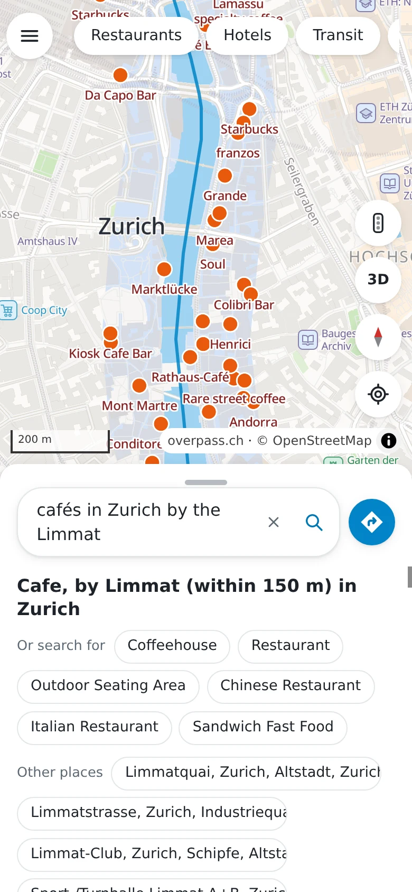
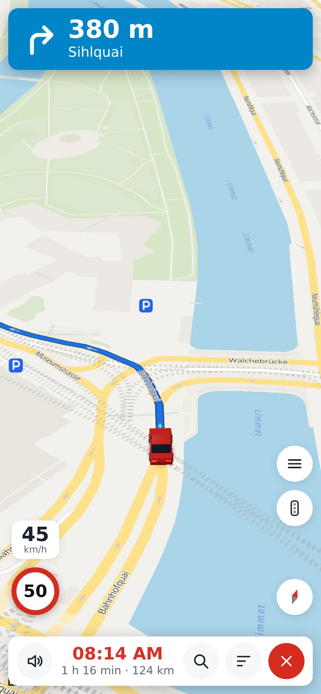
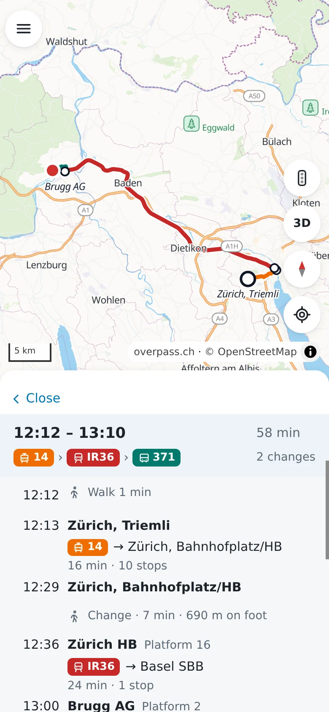

<div align="center">


# hippomaps

**A map app for the web and Android: search in plain words, place pages, directions, public transport and turn-by-turn
navigation, on OpenStreetMap data.**

[**hippomaps.ch**](https://hippomaps.ch) · [Android app](android/README.md) · [Changelog](CHANGELOG.md) ·
[Licence](#licence)


</div>

<table>
  <tr>
    <td width="20%"></td>
    <td width="20%"></td>
    <td width="20%"></td>
    <td width="20%"></td>
    <td width="20%"></td>
  </tr>
  <tr>
    <td align="center"><b>Search</b><br>in plain words</td>
    <td align="center"><b>Places</b><br>hours, photo, contact</td>
    <td align="center"><b>Directions</b><br>car, bike, on foot</td>
    <td align="center"><b>Navigation</b><br>spoken turn by turn</td>
    <td align="center"><b>Public transport</b><br>times, tracks, delays</td>
  </tr>
</table>

## Features

### Search and places

- **Search** in plain words: "cafés in Zurich by the Limmat", "peaks over 4000 m in Valais". Once the map is zoomed or
  moved, the list shows the results in view
- **Place pages**: photo or logo from Wikimedia Commons, opening hours with the next change, website, phone, wheelchair
  access, Wikipedia, all tags. Without a picture of Wikimedia: a photo on Commons taken there that names the place, the
  picture its website shows when shared, a picture of Panoramax looking at it, or the logo of its website. The menu of a
  restaurant, café or bar from its website; the opening hours of the website when OpenStreetMap has none
- **Popups on the map**: the name, kind and, when known, the opening hours and address of a place tapped, and of a place
  under the mouse on a computer
- **What is here**: a tap on the map shows the address and the named places around it
- **A right click on the map** (a long press on a phone): what is here, directions from or to the point, Measure
  distance from it, Reachable from here, its coordinates copied

### Directions and navigation

- **Directions** by car, bike and on foot with up to 8 stops, places along the route (fuel, charging, rest areas, food,
  drinking water…), lanes, junction signs, speed limits, and a height profile by bike and on foot
- **Other routes**: up to two more from start to destination, with how much longer each takes leaving now (live
  traffic and closures counted), on the map and in a row under Start; a tap picks one
- **Public transport**: connections by train, tram, metro, bus, boat and cable car where the server has timetables
  (on hippomaps.ch: Europe), leaving now or with a departure or an arrival at a chosen time, with
  tracks, the walks to and from the stops, and delays where an operator publishes them
- **Signs beside a route by car**: stop signs, speed bumps and speed cameras. Cameras only in countries that allow a
  navigation app to show them: none in Switzerland, Liechtenstein, Germany, France, Cyprus, North Macedonia and Kuwait
  (`server/marks.go`)
- **Navigation** turn by turn with arrows at the turns, a 3D traveller and a preview, spoken in 18 languages chosen
  apart from the language of the page: Bulgarian, Dutch, English, Estonian, Finnish, French, German, Greek, Hungarian,
  Italian, Norwegian, Polish, Portuguese, Romanian, Russian, Spanish, Swedish, Ukrainian
- **Without a connection**: at Start the map along the route is saved on the device (about 15 MB for 25 km by car,
  `web/sw.js`; a switch in the menu turns it off), so navigation goes on along the route with its map and its spoken
  sentences
- **Live traffic** in Switzerland: closures, queues and roadworks on the map and in the route time

### Map

- The compass of a phone: a cone at the location shows where the phone points, and the location button turns the map
  with the phone (Chrome and the other browsers on Android; Safari on the iPhone and iPad asks once from a tap)
- Nine styles, the day map in the colours of Swiss topographic maps, day and night by the sun
- 3D terrain and buildings, relief shading
- Transit lines (metro, light rail, tram) in their colours
- **Measure distance** (the menu, or a right click): points set on the map give the length of the line; the first point
  clicked again closes the shape and gives its area and perimeter. Points are dragged, removed with a click, added on
  the middle of a part; Undo. The height profile of the line, and the line as GPX (with its heights), KML or GeoJSON. A
  GPX, KML or GeoJSON file opened or dropped on the map shows its track as such a line (5000 points at most). The title
  says Measure area while the shape is closed
- **Reachable area** (the menu, from the location of the visitor or the middle of the map; or a right click): how far one
  gets by car (up to an hour, with live traffic), by bike or on foot (up to two hours), in up to four steps of time, each
  a band of its own colour from green to red (the shorter time cut out of it, so colours do not mix) with its area. A
  click on the map or the pin dragged moves the start. The areas as GeoJSON (simplestyle colours, minutes, area, the
  start) or KML (a style per step)
- **Files for a GPS device**: the results of a search as GPX waypoints (beside CSV and GeoJSON), a route as a GPX track
  (with its heights by bike and on foot). Not in the Android app, whose WebView cannot save a file made in the page
- The page in English, German, French and Italian
- Settings, starred places and recent searches stay in the browser
- Feedback from the menu: a problem, a mistake of the map (with a link to a note on OpenStreetMap at the map view), an
  idea; "Report this problem" under a search or route that failed. With the message, unless turned off, the page as it
  was (search, place or route and the map view), the browser and the last errors of the page, listed in the form

### Android

- The site in a WebView with native location, navigation in the background, and links from other map apps (`geo:`,
  Google Maps, OpenStreetMap, Apple Maps)
- The compass of the phone: a cone at the location shows where the phone points; the location button turns the map
  with the phone

## How it works

A Go server serves the page (`web/`, plain JavaScript and MapLibre, no build step) and relays what the browser needs
to other services:

| Service | Used for | Setting |
|---|---|---|
| Map tiles API ([overpass.ch](https://overpass.ch) maps, or a gateway with the same paths) | vector and terrain tiles, styles, geocoding | `TILES_URL`, `MAPS_KEY` |
| [overpass-search](https://gitlab.com/cdutsov/overpass-search) | the search | `SEARCH_UPSTREAM` |
| [Valhalla](https://github.com/valhalla/valhalla) | directions, lanes, speed limits | `ROUTING_URL` |
| [MOTIS](https://github.com/motis-project/motis) (tested with 2.11.4: `POST /api/v6/plan` with the walks to the stops, which come from Valhalla) with timetables (GTFS); it needs no street data | journeys by public transport | `JOURNEY_URL`, `JOURNEY_REGIONS` |
| Overpass API | transit lines, places along a route, stop signs, speed bumps and speed cameras on a route by car | `OVERPASS_URL`, or overpass.ch with `ELEVATION_KEY` |
| overpass.ch elevation API | height profiles | `ELEVATION_URL`, `ELEVATION_KEY` |
| [Piper](https://github.com/OHF-Voice/piper1-gpl) 1.5 or later behind `/say?lang=&text=`, a voice for each language of `sayLangs` (`server/say.go`) | spoken navigation (else the voices of the browser) | `TTS_URL` |
| A traffic service with `/incidents.json` | live traffic | `TRAFFIC_URL` |
| Wikidata and Wikimedia Commons | photos and logos | `PICTURES` |
| The websites of places (their `website` tag, as robots.txt allows), Commons around a place, [Panoramax](https://panoramax.fr) | a picture, the menu and opening hours of a place without them in OpenStreetMap (`server/place.go`) | `PICTURES` and an Overpass API; `PANORAMAX_API` |
| [DB-IP City Lite](https://db-ip.com/db/download/ip-to-city-lite) (MMDB file, monthly, CC BY 4.0) | the map opens at the town of the IP address of the visitor | `GEOIP_DB` |
| `STATS_DIR` | | a directory on a volume for the counts of visits: `stats.json` with, for each day (UTC), the page loads, the visitors and the sites they came from (`Referer` host, or `?ref=name` in the link). No address and no cookie are written; a visitor is counted once a day by a hash with a salt of the day, in memory only. Bots, headless browsers and prefetches are not counted. `hippomaps stats [DAYS [DIR]]` prints the table (`docker exec hippomaps hippomaps stats`) |
| `STATS_IGNORE` | | addresses and networks (comma separated) that are not counted: our own |
| [Stripe](https://stripe.com) Checkout | donations in Swiss francs from the menu (not in the app for Android: Google Play) | `STRIPE_KEY`, `PUBLIC_URL` |
| A directory on a volume, and an SMTP server | feedback from the menu, kept in files and sent by e-mail | `FEEDBACK_DIR`; `FEEDBACK_TO`, `SMTP_*` |

Except for the tiles, each service is optional: without its setting the feature is left out of the page.

## Run

```
go run ./cmd/hippomaps                        # :8096, the page on /labs/maps
docker build -t hippomaps . && docker run -p 8096:8096 -e BASE_PATH=/ hippomaps
```

The Docker build runs `go vet` and the tests.

## Settings

| Setting | Default | |
|---|---|---|
| `LISTEN` | `:8096` | address |
| `BASE_PATH` | `/labs/maps` | path of the page; `/` for a site of its own |
| `PUBLIC_URL` | | public address of the page: makes it indexable (canonical link, `robots.txt`, `sitemap.xml`) |
| `TILES_URL` | `https://api.overpass.ch` | map tiles API |
| `MAPS_KEY` | | key of the tiles API, sent to the browser |
| `SEARCH_UPSTREAM` | | overpass-search, relayed under `{base}/api/search` |
| `SEARCH_API` | `/labs/search/api` | search API as the browser reaches it, when not relayed |
| `ROUTING_URL` | | Valhalla |
| `JOURNEY_URL` | | MOTIS, for the mode Transit of directions (`server/journey.go`). The walks between an end and the stops around it come from `ROUTING_URL`; without it they are straight lines |
| `JOURNEY_REGIONS` | | where MOTIS has timetables: country codes (`CH,BG`), or a part of the world by its UN number (`150`: Europe). The page names them, in its language, where it finds no stop or no connection |
| `OVERPASS_URL` | | Overpass API, asked without a key |
| `ELEVATION_URL` | `https://api.overpass.ch` | elevation API |
| `ELEVATION_KEY` | | overpass.ch key for elevation (and Overpass without `OVERPASS_URL`), server side only |
| `TTS_URL` | | Piper server |
| `TRAFFIC_URL` | | traffic service |
| `GEOIP_DB` | | a MaxMind DB file with a location per network (DB-IP City Lite; GeoLite2 City has the same fields): the map opens at the place of the IP address of the visitor, else in Zurich. A new file renamed over it is opened within a minute. `hippomaps geoip FILE ADDRESS…` looks addresses up in a file |
| `SERVICE_WORKER` | `on` | `off`: `sw.js` becomes a service worker that removes itself and its caches from the browsers that have it (at their next visit), and the page registers none. A rollback of the image does not remove a service worker; this does |
| `STRIPE_KEY` | | a restricted key of Stripe with Checkout Sessions: Write, for donations (`server/donate.go`; needs `PUBLIC_URL` for the way back), server side only. The payment methods of the account but Klarna and Amazon Pay. 10 checkouts per visitor in 10 minutes |
| `FEEDBACK_DIR` | | a directory on a volume for the messages of Feedback (`server/feedback.go`): a JSON file each (mode 600, no IP address), deleted after a year. `hippomaps feedback [N [DIR]]` prints the last ones (`docker exec hippomaps hippomaps feedback`). 5 messages per visitor an hour |
| `FEEDBACK_TO` | | an address that also gets each message by e-mail (Reply-To: the address the visitor gave), through `SMTP_HOST`, `SMTP_PORT` (`587`, STARTTLS; `465`, TLS), `SMTP_USER` (also the sender) and `SMTP_PASSWORD`. Three tries; the file stays either way |
| `PICTURES` | `true` | photos and logos from Wikimedia |
| `PICTURE_CACHE_MB` | `64` | memory for Wikimedia answers and thumbnails |
| `PANORAMAX_API` | `https://api.panoramax.xyz` | pictures of streets for places without a picture; empty: none |
| `PICTURES_PER_IP`, `ROUTES_PER_IP`, `SAYS_PER_IP`, `SEARCHES_PER_IP` | `600`, `120`, `600`, `100` | per visitor in 10 minutes (map taps: three times the searches; journeys by public transport count as directions) |
| `USER_AGENT` | `hippomaps/<version> (+https://gitlab.com/cdutsov/hippomaps)` | for Wikimedia and the other services |

Limits count by `X-Forwarded-For`, so the server belongs behind a proxy that sets it.

## Server API

Under `{base}/api/`; errors are `{"error":{"code","message"}}`.

| | |
|---|---|
| `GET picture?wikidata=Q…&brand=Q…&commons=File:…&w=120` | thumbnail of the place photo, else the chain logo, with credit headers |
| `GET place?osm=node/123&pic=1` | more about a place from its website and free pictures near it: `web`, `site`, `menu` (places to eat and drink), `hours` (when it has no `opening_hours`), with `pic=1` a `picture` (`url`, `kind`, `credit`, `source`, `page`). The server looks up the tags in Overpass and reads only the website they name, on public addresses, as robots.txt allows; kept a week (an hour when Commons or Panoramax did not answer, each waited for 5 s at most) |
| `GET place/picture?osm=node/123` | that picture, written again by the server (500 px, no metadata) |
| `GET kinds?lang=` | the names of the kinds of POIs of the map tiles (`supermarket`, `place_of_worship/christian`) in the language, for the popups |
| `GET route?from=lat,lon&via=…&to=…&mode=car\|bike\|walk&lang=&alts=2` | line, steps, stops, speed limits, lanes, traffic, tunnels, signs on the way (`marks`), height profile; with `alts` (no stops) up to that many other routes in `alts`, each the same |
| `GET journey?from=lat,lon&to=…&time=2026-11-13T08:00:00Z&arrive=1&page=&lang=` | connections by public transport around a time (now without `time`; `arrive=1`: there by then): legs with line, direction, tracks, stops, delays and their way; `earlier` and `later` are the `page` of the connections before and after; the way on foot when the ends are near |
| `POST along` `{"line","cat","mode","lang"}` | places of a kind near a route, in route order |
| `POST heights` `{"line":[[lon,lat],…]}` | the height profile of a line (Measure): `up`, `down`, `min`, `max`, `pts` as [km, m], as that of a route; 2 to 5000 points, 2000 km at most (400 `too_long`); counted as directions of the visitor. Only with `ELEVATION_KEY` (the page then has `data-heights`) |
| `GET reach?at=lat,lon&mode=car\|bike\|walk\|transit&min=15,30,45,60` | how far one gets in those minutes (isochrones of Valhalla; `transit` from MOTIS with `JOURNEY_URL`, `server/reachtransit.go`): GeoJSON, a MultiPolygon per time with `min` and `mode`, the shortest first, coordinates to 5 decimals; 1 to 4 rising times, by car up to 60 (leaving now, with traffic), by public transport up to 60 (leaving now, a cell grid of the stops reached and the walks on from them; `404 no_stops` with no stop near), by bike and on foot up to 120; errors as `route` (`no_road`, `no_route`); as many for a visitor as directions (`ROUTES_PER_IP`), counted apart |
| `GET transit?tile=10/x/y` | transit lines of a tile as GeoJSON |
| `GET say?lang=&text=` | spoken sentence (audio/mpeg) |
| `GET traffic` | traffic incidents |
| `POST feedback` `{"kind","text","email","lang","ctx"}` | a message of Feedback: `kind` `bug`, `map`, `idea` or `other`, `text` up to 4000 characters, `email` optional; `ctx` (optional): `link` (on this site only), `style`, `screen`, `agent`, `errors` (the last 10). 204; 400 `{"error":"kind"\|"text"\|"email"\|"json"}` |
| `GET search/{search,query,complete,here}` | relayed overpass-search; with `lang=de`, `fr` or `it` its English words (the reading, other readings, notes, kinds of places) in that language (`server/labels.go`) |

`GET {base}/sw.js` serves the service worker (`web/sw.js`, scope the page): the page and its files as last loaded, and the
map tiles of the route being navigated (cache `hm-route`, filled by the page at Start), served first.

The start of the page: every file under `static/` has its hash in its address (`?v=`) or the version of its library in
its path, and browsers keep it for a year. The scripts import each other with the hashes (the server writes them into
`import … from "./i18n.js"` as it starts), and the page preloads what `app.js` imports under those addresses.
`web/early.js` runs first and asks for what the map needs before its first tile, while the scripts load: the worker of
MapLibre, and the style, the TileJSON and the icons of the last visit (`hm-early` in the storage of the browser; at a
first visit the light and the dark style). As `app.js` starts it asks for the tiles of the first view and the letters
of the fonts (`hm-first`: where they are, from the last visit), which MapLibre asks for only once its style is loaded.
The page has MapLibre check neither the styles nor its own layers (`validateStyle`, `UNCHECKED` in `app.js`);
`tests/browser.py` checks the style of the map with them.

`GET /privacy` and `/de/privacy` serve the privacy policy (`web/privacy*.html`), linked from the menu.

`GET /healthz` answers `ok`; `hippomaps healthcheck` asks it (the Docker health check).

## Android

`android/` holds the app (Kotlin, one activity, AndroidX only, no Google Play services). `android/build.sh` builds the
signed APK and AAB in Docker; the build is reproducible, so F-Droid can publish it with the same signature. The APK of
each version is on the [GitLab releases](https://gitlab.com/cdutsov/hippomaps/-/releases); F-Droid from February 2027
(its rule of three months of development), Google Play in review. Google Play:
[android/PLAY.md](android/PLAY.md). Store texts and
screenshots are in `fastlane/`. Details: [android/README.md](android/README.md).

## Tests

- `go test ./...`: the server against fakes of Valhalla, MOTIS, Wikimedia, Overpass, the elevation API, Piper, the traffic
  service and overpass-search
- `tests/site-test.sh` (`PAGE=https://…`): a running site end to end; `BROWSER=1` adds `tests/browser.py`, the page in
  headless Chromium on a phone screen, from the first search to navigation

## Layout

```
cmd/hippomaps/   settings, server, healthcheck
server/          page, pictures, directions, journeys by public transport, search relay, transit lines, traffic, voice
web/             index.html, app.js, i18n.js, early.js (the first requests), avatar.js (3D traveller), sw.js (service worker), app.css, icons, vendor/
android/         the Android app
fastlane/        F-Droid texts and screenshots
tests/           tests of a running site
docs/img/        the pictures of this page
CHANGELOG.md     what changed, by release of the Android app
```

## Licence

GPL-3.0-or-later (`LICENSE`). `web/vendor/` holds maplibre-gl 6.13.0 (BSD-3-Clause), three.js 0.170.0 (MIT),
opening_hours 3.15.0 (LGPL-3.0-only) and suncalc 2.0.1 (BSD-2-Clause), each with its licence. `server/labels/presets.json` holds
the names of the iD presets (id-tagging-schema 7.2.0, ISC), built by `server/labels/gen.py`, licence in `server/labels/LICENSE-id-tagging-schema.md`.

Map data © OpenStreetMap contributors (ODbL). Pictures from Wikimedia Commons under the licence each credit names. Traffic:
Federal Roads Office (FEDRO) Traffic Data Platform (TDP). Places of IP addresses: IP Geolocation by DB-IP (CC BY 4.0, not in the
repository; the privacy policy credits it with a link). Voices (Piper, not in the repository): under CC BY the French from the SIWIS
database and Hi-Fi TTS, the Italian from serena-synthetic-it-27h (Marco Baccarani), the Estonian from the speech corpus of Estonian
news sentences and LibriTTS-R; the others CC0 or public domain; the licences page credits them (`/licences`, linked small under the side panel and in the menu). None from the research-only
lessac voice.

---

<div align="center">

Maps, search and elevation by

<a href="https://overpass.ch"></a>

</div>
